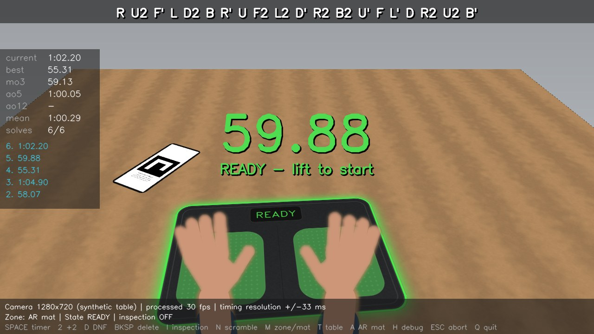

# CubeCam

A csTimer-style Rubik's cube timer that uses your webcam as a virtual stackmat:
rest both hands in the on-screen start zone, lift them to start, put them back
to stop. Stage 1 of a larger project (cube detection, colour reading and move
counting come later).

## Setup

Requires Python 3.12 (developed and tested on 3.12.10; 3.10.11 also worked
before. mediapipe 0.10.21 supports 3.9–3.12, so 3.13+ won't work).

```powershell
cd CubeCam
py -3.12 -m venv .venv                # macOS/Linux: python3.12 -m venv .venv
.\.venv\Scripts\Activate.ps1          # macOS/Linux: source .venv/bin/activate
pip install -r requirements.txt
```

Optional: `python setup_model.py` downloads `models/hand_landmarker.task`. You only
need it for the MediaPipe Tasks backend (see "MediaPipe version" below).

## Run

```powershell
python main.py                 # camera + hand tracking (falls back to keyboard if no camera)
python main.py --no-camera     # keyboard only, like csTimer
python main.py --config other.yaml
```

## How a solve works

| State | What you do |
|---|---|
| IDLE | Last time + new scramble shown. Scramble the cube. |
| → READY | Rest **both hands in the start zone for 0.3 s**. Zone turns green. |
| → INSPECTION (if on) | Lift your hands: the 15 s countdown starts. Beeps and a coloured border appear at 8 s and 12 s. Put your hands back in the zone for 0.3 s to arm again. |
| → SOLVING | Lift your hands from READY. The timer starts at the timestamp of the **first frame** where your hands were out. |
| → STOPPED | Put both hands back in the zone. The time stops at the first frame where they were back. |
| → IDLE | Lift your hands. |

WCA inspection penalties: starting after 15 s gives +2, after 17 s gives DNF.

**Keyboard fallback:** the spacebar acts like "hands in zone". On Windows it works
exactly like csTimer: hold space for 0.3 s, release to start, press to stop. On
other OSes OpenCV can't see key releases, so each press *toggles* the held state.

### Keys
`SPACE` timer · `2` toggle +2 on last solve · `D` toggle DNF · `Backspace` delete
last solve · `I` toggle inspection · `N` new scramble · `H` debug overlay ·
`M` start-zone / mat setup (see below) · `T` table calibration for the AR mat ·
`A` AR mat look on/off · `Esc` abort current solve (not recorded) · `Q` quit

## Setting up the start zone ("mat")

The start zone is where you rest your hands. A hand counts as "in the zone" when
its **palm centre** (the average of the wrist and the four knuckles) is inside the
zone. The zone can be any polygon, not just a rectangle. Hold time and debounce
work exactly as before; only the inside/outside test changed.

### Camera angle first
The camera must **see the desk area where your hands rest**, not just you. Tilt it
down (or put it higher, looking down at the desk) until the mat is in the lower
half of the picture with some room around it. Your hands must stay visible while
they rest, so don't let the timer window or a laptop lid cut them off. Even light
from the front helps the hand tracker. If you move the camera later, set the zone
again, or use marker mode, which follows the mat.

### Ways to set it
Press `M` while the timer is idle. `M` again moves to the next mode. With a
calibrated table (see "AR mat" below) the first mode places the AR mat instead of
dragging a rectangle. `Enter`
accepts the zone shown and saves it to `config.yaml` (it persists across
restarts). `R` starts the current mode over. `Esc` cancels and keeps the old zone.
While the setup is open the timer ignores your hands, so resting them there
can't arm it.

1. **Drag** (`M`): click and drag a rectangle over the area where you rest your
   hands, then press `Enter`. Drag again to redo it.
2. **Hands** (`M` `M`): rest both hands where you want the mat, as you would
   before a solve, and hold still. A bar fills over about 2 s; if a hand moves
   more than about 3 % of the frame width, or isn't seen for more than a quarter
   of a second, it starts again. The zone is a rectangle around both whole hands
   plus a margin of about 0.6 x your palm size on each side, so your palms are
   still inside when you put your hands down slightly differently next time.
   Check it and press `Enter`.
3. **Markers** (`M` `M` `M`, optional): use 4 printed markers at the corners of a
   physical mat. The zone is the shape through the marker centres, so it can be
   a trapezoid if the camera looks at the desk at an angle.
   * Run `python tools/make_markers.py`. It writes `markers.pdf` and `markers.png`,
     an A4 page with the 4 markers (60 mm; `--size 40`..`85` to change), cut lines,
     instructions and a 50 mm scale bar.
   * Print at **100 % / actual size**, cut the markers out with their white border,
     and tape them flat at the 4 corners of the mat. Any marker can go at any
     corner, either way up.
   * In marker mode, wait for "4/4 markers" and press `Enter`.
   * The markers are re-detected about 4 times per second in a background thread
     (it never slows the timer). If the camera is bumped, the zone moves with
     the mat. If one marker is hidden under a hand, its position is estimated
     from the other three. If more are hidden, the last known zone is kept. The
     status bar shows `Zone: markers (4/4 markers)` and so on.
   * The saved points are used at startup until the markers are seen again.
     Choosing a drag or hands zone switches marker mode off.

**Warnings.** If a zone is mostly outside the camera picture (less than half of it
visible) or too small (under 2 % of the frame, or narrower than 12 % of its
width), the setup shows it in orange with a warning before you accept. An active
zone with that problem also shows an orange outline and a "ZONE WARNING" line in
the status bar.

## AR mat: a virtual mat lying on your table



Once the app knows where the table is, it draws a start mat that looks like it's
lying flat on your real table in perspective. That outline is the timer's start
zone. The mat shows the timer state itself:
* **Idle:** dark mat, "REST HANDS".
* **Holding:** the hand pads fill up in yellow.
* **Ready:** green pads and a green glow round the mat.
* **Solving:** a thin red rim.

Your hands are drawn on top of the mat: it is cut away wherever a hand is.
The mat graphic is original (no brand names or logos). More screenshots, made from
a synthetic table with `python tools/ar_screenshots.py`, are in
`docs/screenshots/ar_mat/`: idle, holding, ready, solving, AR off, the calibration
screen and the mat placement screen.

Without a table calibration nothing changes: the zone works as described above.
`A` switches the AR look off, back to the plain zone outline. The zone stays the
same.

### 1. Calibrate the table (`T`, timer idle)
The app needs the homography between the table surface (in centimetres) and the
camera picture. It is saved to `config.yaml` (`table_calibration:`).

**Phone marker (main method)**
1. Run `python tools/make_phone_marker.py`. This writes `phone_marker.png` (1080 x 2340).
   `--width/--height` fit other screens.
2. Copy it to your phone and open it full screen. Turn the brightness up.
3. **Once:** measure the black square on your phone with a ruler (outer edge to outer
   edge, mm) and enter it as `table.phone_marker_mm` in `config.yaml`. It sets the
   real-world scale. Without it a typical phone (56 mm) is assumed and the app says
   the scale is approximate. Only the mat's real size in cm depends on it; the mat
   still lies flat in correct perspective.
4. Lay the phone **flat** on the table where the camera sees it well, roughly where
   the mat will go. Press `T`. The marker is found automatically, outlined in green,
   and a 10 cm grid is drawn on the table. Keep the phone still until the bar is
   full (the corners are averaged over about 10 detections), check that the grid
   lies flat on the table, and press `Enter`.

**Click 4 corners (fallback: `T` again)**
Use any rectangle of known size lying on the table: an A4 sheet, a book, the phone
itself.
1. Click its 4 corners **in order round its edge**. A 3x zoom loupe follows the mouse.
   Right-click or `Backspace` undoes a click.
2. Give the size. `A` = A4, `L` = US Letter (press again to turn it 90°), or type
   it in cm, e.g. `29.7x21`. The first number is the edge from click 1 to click 2.
3. Check the grid and press `Enter`.

**4-marker mode** (see above) provides the table plane by itself: each printed
marker is a square of known size (`markers.size_mm`, 60 by default), so with marker
mode on, the AR mat is drawn on the printed mat and follows it.

`X` in the calibration screen forgets the saved calibration; the zone stays where
it was, as a flat zone.

**Warnings.** The app warns when the camera sees the table almost edge-on (under
about 20°) or the reference is very small in the picture (under about 0.1 % of the
frame).

*How it's computed:* a plain 4-point homography from a 5 cm marker extrapolates
badly half a metre away (10-20 % errors at shallow angles in tests). So the camera
pose is fitted instead (`cv2.solvePnP`). The focal length is estimated from the same
view and kept within a webcam-like 50-90° field of view; set
`table.camera_hfov_deg` if you know your camera's. On synthetic tables this gives
about 1-2 % median scale error over 50 cm (worst case about 10 %). With an A4 sheet
it is under 3 %.

### 2. Place the mat (`M`)
After calibrating, mat placement opens by itself (later: `M`).
* **Drag** the mat with the mouse. It slides across the table in correct perspective
  (smaller when further away). `[` and `]` rotate it by 5°. `R` puts it back in the
  default spot. `Enter` saves it (`mat_placement:` and the zone in `config.yaml`).
* **Hands** (`M` again): rest both hands where you want the mat and hold still for
  about 2 s. The mat is built on the table centred between your palms and turned
  to follow the line between them. It keeps its size unless your hands are wider
  apart; then it gets wider so each palm has about 6 cm of room to the edge.
* The size is `mat.width_cm` / `mat.height_cm` (default 30 x 22 cm).

### Tips
* **Camera angle:** the camera must see the table where your hands rest, from
  above if possible. A laptop camera pointed straight ahead sees the table almost
  edge-on (warning). Tilt the screen back or raise the camera so the table is
  seen at 25° or more.
* **Glare:** reflections on the phone screen hide the marker. Tilt the phone a
  little away from lamps and windows, or switch the light off for the calibration.
* **Re-calibrate if the laptop or camera moves.** The mat is tied to the
  calibration, not to the table, so it would slide with the picture. Press `T`
  again: the mat keeps its place on screen. With 4-marker mode the mat follows the
  markers automatically.
* If the hand cut-out looks wrong (e.g. sleeves the same colour as the table), it
  is only cosmetic. The timer uses the palm centres, not the picture.

### How it is drawn, and why it doesn't slow the timer
* The mat graphic is made once per size and state: dark rubber, rounded corners,
  two pads with grip dots, a status window and a bevelled border. It is warped
  into perspective with `cv2.warpPerspective`, and the result is cached. A new warp
  only happens when the plane, the mat or the state changes. Other states are
  prepared in a background thread, so a state change never stalls a frame.
* Each frame only composites the cached mat (`cv2.blendLinear`) and cuts out the
  hands:
  * The hand shape comes from the landmarks (palm, finger bones, a stub of the
    forearm).
  * Skin-coloured pixels near the hands are added, but only if they differ from a
    slowly updated clean picture of the table under the mat. A light-wood desk is
    "skin-coloured" too.
  * The mask is built at reduced resolution and feathered at the edges.
* **Measured on this machine:** 30 fps webcam, 1280x720, real hand tracking, the
  same 6 s window with AR off / on / off again:

  | AR mat | processed FPS | AR cost per frame |
  |---|---|---|
  | off | 29.7 | - |
  | on, two hands over the mat | 29.7 | 3.6 ms median (4.8 ms p95) |
  | on, no hands over the mat | 29.7 | 1.1 ms median |
  | off again | 29.6 | - |

  Processed FPS stays at the camera's rate. `AR ms` appears in the `H` debug overlay.

## Configuration (`config.yaml`)

The main settings are the zone, camera index, resolution and requested FPS, hold
time, debounce, and inspection on/off.
Missing keys fall back to the defaults in `config.py`.
The zone is stored as

```yaml
zone:
  mode: fixed       # fixed = these points; markers = follow the 4 markers; mat = the AR mat
  points: [[0.1, 0.68], [0.9, 0.68], [0.9, 0.98], [0.1, 0.98]]
```

in fractions of the displayed (mirrored) picture, with 0,0 at the top left. `M`
rewrites only this block and keeps the rest of the file and its comments. Older
configs with `x`, `y`, `w`, `h` still load as a rectangle. The `markers:`
section sets the ArUco dictionary and ids (`DICT_4X4_50`, ids 0-3), how often
they are detected, and at what resolution. `table:` holds the phone marker size,
its id and optionally the camera's field of view, and `mat:` holds the AR look and
mat size. The app writes `table_calibration:` (`T`) and `mat_placement:` (`M`)
itself; delete them to reset. Solves are saved to
`solves.json` (time, penalty, scramble, timestamp, measured FPS, inspection time)
and reloaded on startup.

## Timing accuracy

* A dedicated capture thread calls `grab()` and takes `time.perf_counter()` right
  after it. Slow hand detection can't delay timestamps. Camera latency is nearly
  constant, so it cancels out between the start and stop frames.
  (`CAP_PROP_POS_MSEC` is unreliable for live webcams on Windows, so it isn't used.)
* Debounce (default 50 ms) filters tracking flicker. Each edge is still
  timestamped at the *first* changed frame, so debounce adds display latency but
  no timing error.
* The status bar shows the capture FPS, the FPS actually processed by the hand
  tracker, and the resulting resolution (±1 processed frame). On a 30 fps webcam
  that's about ±33 ms. A 60/120 fps camera improves it proportionally, as long as
  detection keeps up (see `detect ms` in the debug overlay; lower
  `detection.process_width` if it doesn't).
* With DirectShow, the "driver says" FPS is often wrong. Trust the measured number.

## MediaPipe version

`hands.py` supports both MediaPipe APIs (`detection.backend: auto | legacy | tasks`):

* **legacy** `mp.solutions.hands` – the pinned mediapipe 0.10.21 is the last release with it. It needs no model file.
* **tasks** `HandLandmarker` – mediapipe 1.x only has this API. It needs `python setup_model.py`.

mediapipe 0.10.21 is pinned because on the dev machine Windows Smart App Control /
Application Control **blocked the native DLL of mediapipe 1.2.3** (`WinError 4551`),
while 0.10.21 loads fine. If hand tracking fails to load, the app says why,
keeps showing the camera and stays usable with the spacebar.

## Architecture

| File | Role |
|---|---|
| `main.py` | App loop: wires camera → detector → state machine → UI, keys, saving |
| `camera.py` | Threaded capture with per-frame timestamps, measured FPS |
| `detection.py` | `TriggerDetector` interface, `NullDetector`, `CombinedDetector` |
| `hands.py` | `HandZoneDetector`: MediaPipe → "≥2 palm centres inside the zone polygon" per frame |
| `zone.py` | Zone polygon (inside test, clipping, warnings) and the hands-mode zone builder |
| `zone_setup.py` | `M` setup modes: drag, hands, markers (pure logic, drawn by `ui.py`) |
| `markers.py` | ArUco marker detection in a background thread → zone that follows the mat |
| `tools/make_markers.py` | Printable A4 PDF/PNG of the 4 markers with instructions |
| `plane.py` | Table plane: homography cm ↔ px, pose-based fit from a known rectangle, angle / size warnings |
| `table_calib.py` | `T` calibration: phone marker (averaged) or 4 clicks + size (pure logic) |
| `ar_mat.py` | The mat on the plane (place, rotate, build round hands), mat graphic, cached warps, hand cut-out |
| `synth_table.py` | Synthetic camera views of a table, phone and hands (tests, screenshots) |
| `tools/make_phone_marker.py` | Phone-screen PNG with the calibration marker |
| `tools/ar_screenshots.py` | Renders the AR mat screenshots in `docs/screenshots/ar_mat/` |
| `timer_state.py` | Pure state machine (no OpenCV, no clock) fed `(timestamp, active)` samples |
| `stats.py` | best, mo3, ao5, ao12, mean (WCA rules: trim best/worst, DNF = worst) |
| `scramble.py` | 20-move random-move scrambles (no `R R'`, no `R L R`) |
| `storage.py` | Atomic JSON save/load, backs up a corrupt file |
| `ui.py` | OpenCV drawing from a `ViewModel` |
| `keyinput.py` | Spacebar held-state (Windows `GetAsyncKeyState`) |
| `config.py` / `config.yaml` | Defaults + user config |

A future cube-motion detector implements `TriggerDetector.process(frame, t) ->
TriggerSample` and can replace the hand detector or be combined with it via
`CombinedDetector([hands, cube], mode="all"|"any")`. The state machine only ever
sees a boolean per timestamp.

## Tests

```powershell
python -m pytest -q
```

They cover the state machine (synthetic 60 fps frame streams with flicker, debounce
bias, inspection +2/DNF boundaries, warnings and abort), stats (ao5/ao12 with DNFs
and +2), scrambles and storage. `tests/test_zone.py` covers the zone:
* **Geometry:** rectangles, concave and slanted polygons, edges, clipping to the
  frame, the "mostly outside" and "too small" warnings, and old vs new config formats.
* **Hands-mode builder:** it needs 2 s of stillness, restarts on movement or slow
  drift, forgives a brief dropout, ignores a third hand, and the margin covers
  both hands.
* **Setup modes and detector:** drag, hands and marker setup flows, and the
  detector using the palm centre inside a trapezoid.

`tests/test_ar_mat.py` covers the AR mat:
* **Plane:** homography round trips (table → image → table), the canonical axes
  (mirrored too), the horizon, resolution changes, config round trips, the
  elevation estimate and the "edge-on" / "too small" warnings, and the focal
  length estimate.
* **Phone marker:** detected on a synthetic picture of a phone lying on a table at
  an angle, mirrored and not, with glare. The distances measured through the
  calibrated plane are within 5 % over 50 cm. Also several poses, averaging that
  restarts when the phone moves, and the "approximate scale" note.
* **4-click calibration:** an A4 sheet within 3 %. Also the preset turned 90°
  (clearly wrong, so it is detected), typed sizes, undo, a bow-tie click order
  rejected, and the loupe position.
* **Mat:** placement, dragging in perspective, rotation, refusing the horizon,
  hands mode on the plane (centre, angle, widening), re-anchoring after
  re-calibration, and the zone being the projected outline.
* **Drawing:** the texture states (ready glow), warp caching (nothing re-warped
  for a steady mat), and the hand mask covering hands but not a skin-coloured
  table. Also that skin pixels extend the landmark shape, the hands staying on top
  of the drawn mat, and a per-frame cost check.
* **Markers:** detected in a synthetic perspective desk scene (mirrored and not),
  the estimated 4th marker and the hold when markers are covered, and the printed
  sheet is detectable with a well-formed PDF.
* **Saving the zone:** comments and other settings in `config.yaml` are kept.
